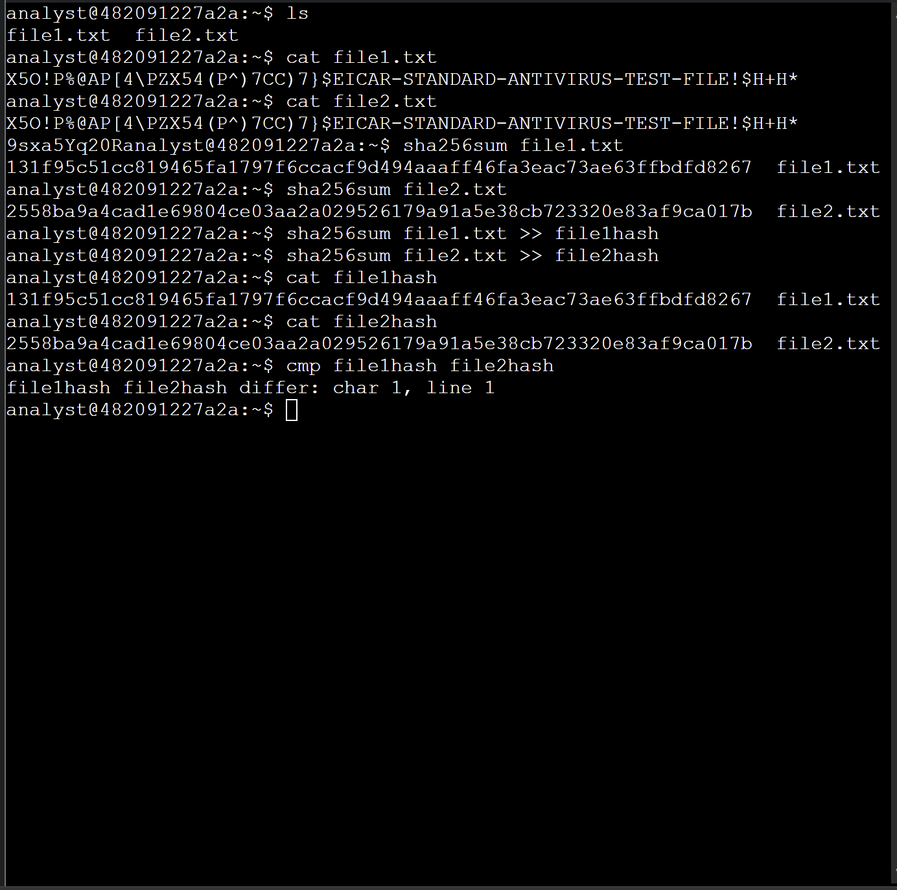

# Linux Security Investigation: File Integrity Monitoring & Hashing

## Scenario
As a security analyst, I was tasked with investigating two seemingly identical files to detect any unauthorized modifications or tampering. The objective was to utilize cryptographic hashing to verify file integrity.

## Task
Utilize Linux command-line tools (`sha256sum`, `cat`, `cmp`) to generate, record, and compare the cryptographic hashes of standard test files (EICAR).

## Action
- Executed the `cat` command to inspect the raw contents of `file1.txt` and `file2.txt`, identifying appended anomalous data in the second file.
- Generated cryptographic hashes using the `sha256sum` utility to create a unique digest for each file.
- Utilized output redirection (`>>`) to save the hashes into specific log files (`file1hash`, `file2hash`) for documentation.
- Executed the `cmp` command to programmatically compare the two hash logs, instantly confirming a mismatch (`differ: char 1, line 1`).

## Outcome
Successfully proved that the second file had been altered despite containing the original EICAR test string. This project demonstrates practical proficiency in File Integrity Monitoring (FIM), cryptographic hashing (SHA-256), and core Linux CLI operations for security auditing.

## Terminal Output

