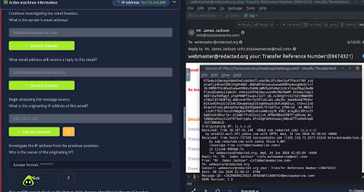
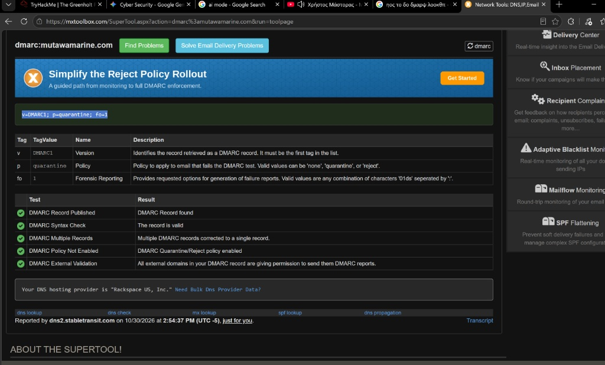
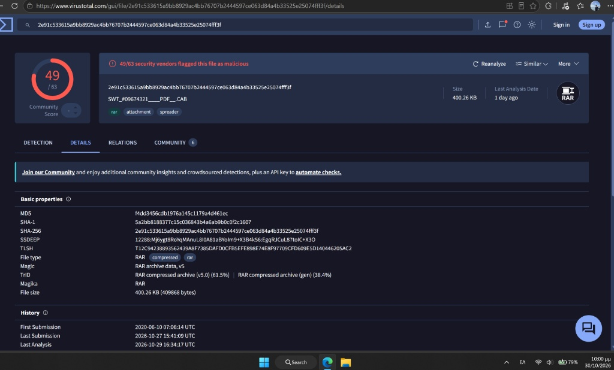
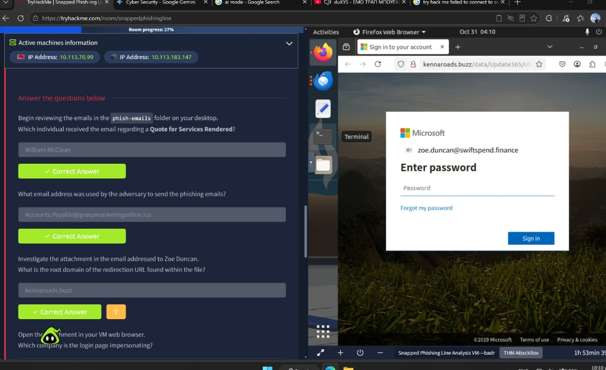
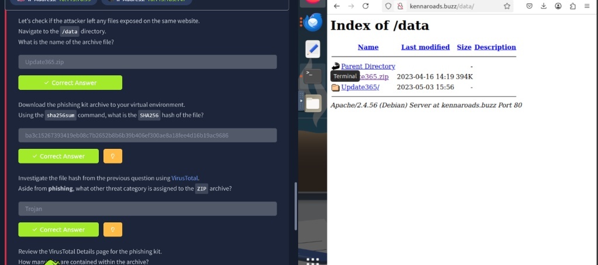
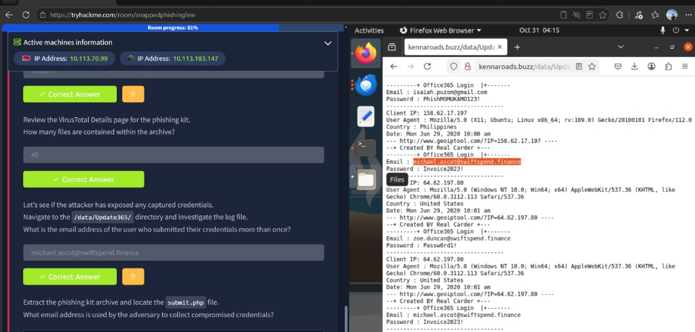
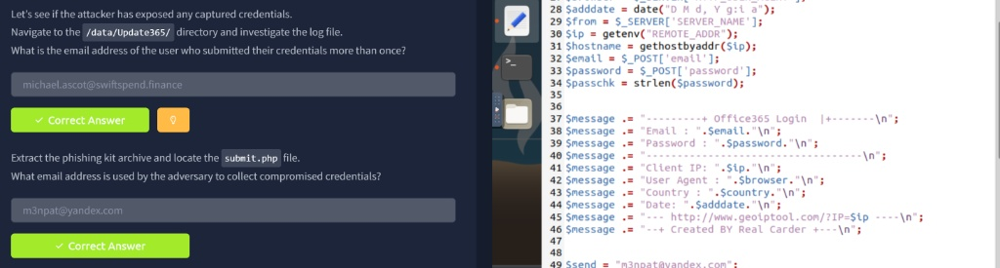

# 🎣 Phishing Forensics: BEC Header Analysis & Phishing Kit Reverse Engineering

## 📌 Executive Summary
This project documents two end-to-end phishing investigations conducted within the TryHackMe SOC Level 1 curriculum (**The Greenholt Phish** and **Snapped Phish-ing Line**). The investigations demonstrate practical L1/L2 SOC workflows across the full email attack lifecycle: from inspecting raw RFC 5322 email headers, auditing DNS authentication records (**SPF/DMARC**), and analyzing malicious archives via **VirusTotal**, to pivoting into an attacker's open web directory, reverse-engineering a harvested **Office 365 Phishing Kit (`submit.php`)**, and identifying compromised corporate accounts.

* **Tools & Utilities:** Mozilla Thunderbird, Linux CLI (`dig`, `sha256sum`, `unzip`), MXToolbox, WhatIsMyIPAddress, VirusTotal, Firefox DevTools
* **Core Competencies:** Email Header Forensics, SPF/DMARC Auditing, Double-Extension Malware Triage, Open Directory Pivoting, Phishing Kit Source Code Review, Breach Scope Assessment

---

## 🔍 Case Study 1: Business Email Compromise (BEC) & Malicious Archive ("The Greenholt Phish")

### 1. Incident Context & Initial Triage
A sales executive at Greenholt PLC escalated a suspicious SWIFT wire transfer confirmation email purporting to come from a known client (`Mr. James Jackson <info@mutawamarine.com>`) with the subject **`webmaster@redacted.org your: Transfer Reference Number:(09674321)`**.

### 2. Email Header Forensics & Spoofing Detection
Inspecting the raw message source (`challenge.eml`) revealed critical anomalies between the display headers and routing metadata:
* **Sender Address:** `info@mutawamarine[.]com`
* **Reply-To Manipulation:** `info.mutawamarine@mail[.]com` (redirecting replies to an external free webmail provider).
* **Originating Sender IP:** `192[.]119[.]71[.]157` (`hwsrv-737338.hostwindsdns.com`), which resolved via OSINT lookup to **HostPapa** (Data Center/Transit ISP in Buffalo, NY).

### 3. Email Authentication Auditing (SPF & DMARC)
To verify whether `192.119.71.157` was authorized to send mail on behalf of `mutawamarine.com`, I queried the domain's DNS TXT records using `dig` and **MXToolbox**:
* **SPF Record (`dig txt mutawamarine.com`):** `v=spf1 include:spf.protection.outlook.com -all` (Hard fail `-all` for any non-Microsoft 365 server, proving the HostPapa IP was spoofed).
* **DMARC Record:** `v=DMARC1; p=quarantine; fo=1` (Configured to quarantine failed messages and generate forensic reports).

### 4. Malicious Attachment Triage (`SHA-256` & VirusTotal)
The email contained a 400.26 KB attachment named **`SWT_#09674321____PDF__.CAB`**, using multiple underscores and a fake `PDF` string to disguise a `.CAB` extension.
* **Calculated SHA-256 Hash (`sha256sum`):** `2e91c533615a9bb8929ac4bb76707b2444597ce063d84a4b33525e25074fff3f`
* **VirusTotal Verdict:** Flagged by **49/63 security vendors** as malicious. File magic/TrID inspection confirmed the actual file type is a **RAR archive (v5)** acting as a malware spreader.

---

## 🚨 Case Study 2: Credential Harvesting Campaign & Phishing Kit Analysis ("Snapped Phish-ing Line")

### 1. Campaign Triage & Redirection Analysis
Multiple employees across SwiftSpend Financial reported suspicious invoice/quote emails sent from **`Accounts.Payable@groupmarketingonline[.]icu`**.
* Inspecting the HTML attachment sent to `zoe.duncan@swiftspend.finance` revealed an embedded redirection script pointing to **`http://kennaroads[.]buzz/data/Update365/office365/`**.
* Rendering the payload in an isolated browser session exposed a cloned **Microsoft Office 365** credential harvesting portal pre-populated with the victim's corporate email address.

### 2. Infrastructure Pivoting & Phishing Kit Acquisition
By truncating the URL path to **`http://kennaroads[.]buzz/data/`**, I discovered an exposed Apache directory listing (`Index of /data`) left open by the adversary:
* **Extracted Archive:** `Update365.zip` (containing 49 files).
* **SHA-256 Hash:** `ba3c15267393419eb08c7b2652b8b6b39b406ef300ae8a18fee4d16b19ac9686`
* **Threat Classification:** Flagged on VirusTotal under **Phishing / Trojan**.

### 3. Data Breach Scope Assessment (Victim Log Discovery)
Navigating to `/data/Update365/` uncovered an exposed plaintext log file recording every victim who had already submitted credentials to the phishing portal. Cross-referencing the logs identified compromised internal accounts:
* **`zoe.duncan@swiftspend.finance`** (Submitted credentials from IP `64.62.197.80`).
* **`michael.ascot@swiftspend.finance`** (Submitted credentials **twice** from IP `64.62.197.80`).

### 4. Phishing Kit Source Code Analysis (`submit.php`)
After extracting `Update365.zip` locally, I audited the backend harvesting script (**`submit.php`**). The PHP script captures `$_POST['email']`, `$_POST['password']`, `REMOTE_ADDR`, and `HTTP_USER_AGENT`, formats a banner (`Created BY Real Carder`), and exfiltrates the stolen credentials directly to the attacker's drop email address:
* **Adversary Exfiltration Email:** `m3npat@yandex[.]com`

---

## 📊 Consolidated Indicators of Compromise (IoCs)

| Indicator Type | Value (Defanged) | Context / Role | Verdict |
| :--- | :--- | :--- | :--- |
| **IPv4** | `192[.]119[.]71[.]157` | Originating Sender IP (Greenholt Phish) | Malicious (Spoofed) |
| **Email** | `info.mutawamarine@mail[.]com` | Reply-To Drop Address (BEC) | Malicious |
| **SHA-256** | `2e91c533615a9bb8929ac4bb76707b2444597ce063d84a4b33525e25074fff3f` | `SWT_#09674321____PDF__.CAB` (RAR) | Malicious (49/63 VT) |
| **Email** | `Accounts.Payable@groupmarketingonline[.]icu` | Phishing Campaign Sender | Malicious |
| **Domain** | `kennaroads[.]buzz` | Credential Harvesting & Kit Hosting | Malicious |
| **SHA-256** | `ba3c15267393419eb08c7b2652b8b6b39b406ef300ae8a18fee4d16b19ac9686` | `Update365.zip` Phishing Kit | Malicious (Trojan/Phish) |
| **Email** | `m3npat@yandex[.]com` | Attacker Credential Exfiltration Drop (`submit.php`) | Malicious |

---

## 🛡️ Remediation & Incident Response Actions
1. **Immediate Account Containment:** Force password resets and revoke active OAuth/session tokens for compromised SwiftSpend users (`michael.ascot@swiftspend.finance` and `zoe.duncan@swiftspend.finance`), and audit their sign-in logs for unauthorized access from external IPs.
2. **Perimeter & Email Gateway Blocking:** Block sender domains (`groupmarketingonline[.]icu`), drop addresses (`m3npat@yandex[.]com`, `info.mutawamarine@mail[.]com`), originating IP (`192[.]119[.]71[.]157`), and phishing domain (`kennaroads[.]buzz`) across the Secure Email Gateway (SEG) and perimeter firewall.
3. **Mail Policy Hardening:** Enforce strict SPF (`-all`) and DMARC (`p=reject` or `p=quarantine`) validation on inbound mail gateways, and strip/quarantine double-extension archives (`.pdf.cab`, `.rar`).
