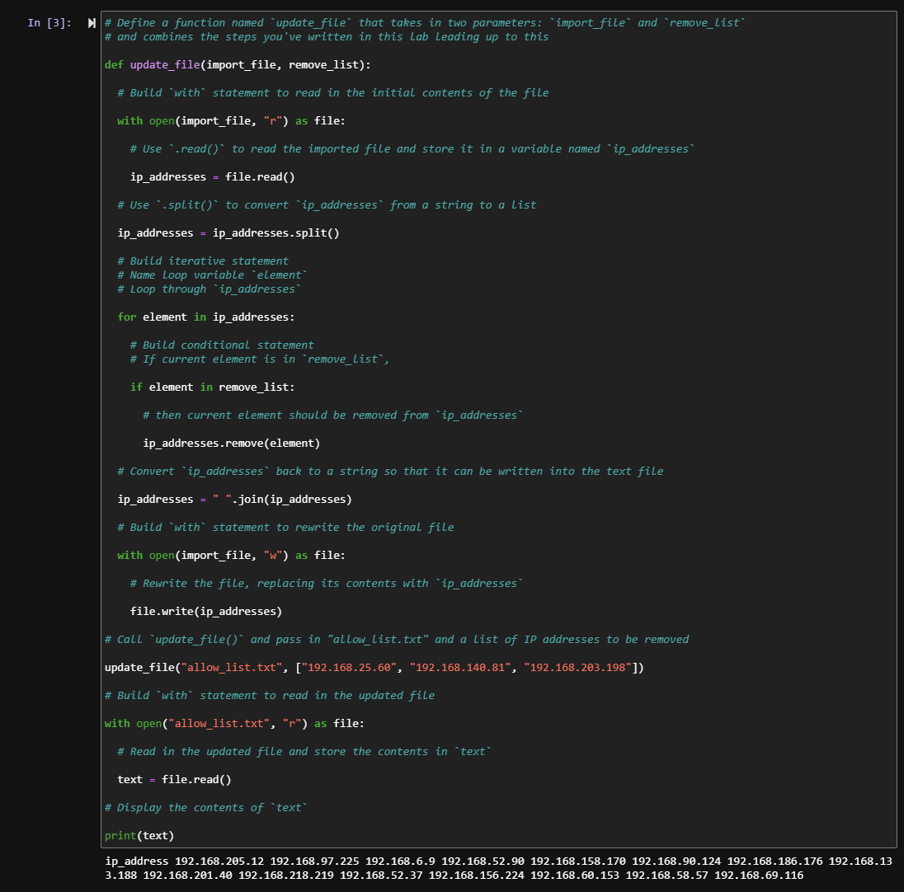

# Python Automation: Updating Network Access Control Lists (IP Allow List)

## Project Description
At a healthcare organization, access to restricted patient records is governed by an IPv4 allow list (`allow_list.txt`) that permits authorized employees to sign into the restricted subnetwork. Whenever employees change roles or leave the organization, their IP addresses are added to a `remove_list` and must be revoked immediately. Manually editing access control files across multiple subnetworks is time-consuming and prone to human error. In this project, I developed a reusable Python algorithm (`update_file`) that automates the ingestion, parsing, sanitization, and rewriting of the IP allow list file.

---

## Algorithm Breakdown & Implementation

### 1. Open the File Containing the Allow List
To safely access the `allow_list.txt` file, I assigned the filename to the `import_file` parameter and used Python's `with` statement alongside the `open()` function in read mode (`"r"`). The `with` statement ensures proper resource management by automatically closing the file stream once the block finishes executing:
```python
with open(import_file, "r") as file:
```

### 2. Read the File Contents
Inside the context manager block, I applied the `.read()` method on the file object to extract the entire contents of the allow list and store them as a single string variable named `ip_addresses`:
```python
    ip_addresses = file.read()
```

### 3. Convert the String into a List
To evaluate and remove individual IP addresses programmatically, the raw string must be converted into a mutable data structure. I used the `.split()` method on the `ip_addresses` string, which splits the text by whitespace/newlines and returns a structured Python list of individual IP elements:
```python
ip_addresses = ip_addresses.split()
```

### 4. Iterate Through the IP Addresses
To inspect the addresses against the revocation list (`remove_list`), I implemented a `for` loop using `element` as the loop variable to iterate over the addresses:
```python
for element in ip_addresses:
```
*(Note: Iterating directly over `remove_list` (`for element in remove_list:`) is also supported as an optimization to prevent list mutation indexing shifts).*

### 5. Remove Unauthorized IP Addresses
Within the loop body, a conditional `if` statement checks whether the current IP `element` exists in the `remove_list`. When a match is found, the `.remove()` method deletes that specific IP address from the `ip_addresses` list. Applying the `.remove()` method in this manner is safe and effective because there are no duplicate IP entries in the `ip_addresses` allow list:
```python
    if element in remove_list:
        ip_addresses.remove(element)
```

### 6. Update the File with the Revised List of IP Addresses
Once all revoked IPs are removed, the list must be converted back into a string before writing it to disk. I used the `.join()` method (applying either `" "` or `"\n"` as a delimiter) to concatenate the elements back into a single string. Finally, a second `with open(import_file, "w") as file:` block opens the file in write mode (`"w"`), and `file.write(ip_addresses)` overwrites the old file with the sanitized IP allow list:
```python
ip_addresses = " ".join(ip_addresses)

with open(import_file, "w") as file:
    file.write(ip_addresses)
```

---

## Verification & Execution Output
The algorithm was encapsulated into the `update_file(import_file, remove_list)` function and executed against `"allow_list.txt"` to revoke three unauthorized IP addresses (`"192.168.25.60"`, `"192.168.140.81"`, `"192.168.203.198"`). Subsequent read verification confirmed that all three addresses were successfully purged from the access list.

### Code & Execution Screenshot


---

## Summary
This Python automation algorithm streamlines Identity and Access Management (IAM) and network perimeter hygiene by programmatically revoking unauthorized IP addresses. By combining context managers (`with open()`), string manipulation methods (`.read()`, `.split()`, `.join()`), iterative conditional checks (`for` / `if`), and list mutation (`.remove()`), the script eliminates manual configuration drift. Furthermore, encapsulating the workflow into a parameterized function (`update_file`) allows security analysts to reuse the code across multiple firewall or subnetwork access files with minimal effort.
