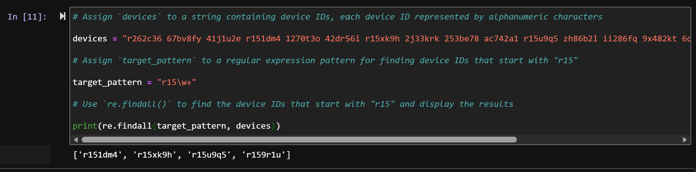

# Automated Security Log Parsing & Triage with Python Regular Expressions

## Scenario
As a security analyst, manual log inspection is inefficient and prone to human error when auditing device compliance or investigating anomalous authentication attempts. In this project, I developed automated extraction pipelines using Python's regular expressions (`re` module) to:
1. Identify non-compliant endpoints requiring operating system updates based on device identifier patterns.
2. Extract IPv4 addresses from raw multi-user authentication logs and cross-reference them against a dynamic threat watchlist (flagged IP indicators).

## Objectives
* Apply regular expression meta-characters (`\w+`, `\d{1,3}`, `\.`) to match structured security telemetry.
* Automate the extraction of target indicators using `re.findall()`.
* Implement conditional iteration logic (`for` loops and membership operators) to automate threat triage decisions.

---

## Technical Implementation

### Task 1: Compliance Auditing via Device ID Pattern Matching
To identify devices requiring critical OS patches (defined by the prefix `r15`), I constructed an alphanumeric pattern using `\w+` and extracted matching IDs from the environment inventory string:

```python
import re

# Raw inventory string
devices = "r262c36 67bv8fy 41j1u2e r151dm4 1270t3o 42dr56i r15xk9h 2j33krk 253be78 ac742a1 r15u9q5 zh86b21 ii286fq 9x482kt 6d..."

# Target pattern: matches literal 'r15' followed by one or more alphanumeric characters
target_pattern = "r15\w+"

# Extraction and reporting
matching_devices = re.findall(target_pattern, devices)
print(matching_devices)
```

**Output:**
```python
['r151dm4', 'r15xk9h', 'r15u9q5', 'r159r1u']
```
*Identified 4 endpoints operating on legacy software versions slated for immediate update workflows.*

---

### Task 2: Automated IP Extraction & Indicator Triage
Raw authentication logs containing mixed user, timestamp, and IP data were parsed using bounded digit quantifiers (`\d{1,3}`) to ensure only valid IPv4 octets were captured, filtering out corrupted artifacts. The parsed addresses were then evaluated against a security alert watchlist:

```python
import re

# Raw login attempt log stream
log_file = "eraab 2022-05-10 6:03:41 192.168.152.148 \niuduike 2022-05-09 6:46:40 192.168.22.115 \nsmartell 2022-05-09 19:30:..."

# Regex pattern strictly enforcing 1-3 digits per IPv4 octet
pattern = "\d{1,3}\.\d{1,3}\.\d{1,3}\.\d{1,3}"

# Extract all valid IP addresses
valid_ip_addresses = re.findall(pattern, log_file)

# Threat Intelligence flagged IP list
flagged_addresses = ["192.168.190.178", "192.168.96.200", "192.168.174.117", "192.168.168.144"]

# Triage execution loop
for address in valid_ip_addresses:
    if address in flagged_addresses:
        print("The IP address", address, "has been flagged for further analysis.")
    else:
        print("The IP address", address, "does not require further analysis.")
```

**Output Stream:**
```text
The IP address 192.168.152.148 does not require further analysis.
The IP address 192.168.22.115 does not require further analysis.
The IP address 192.168.190.178 has been flagged for further analysis.
The IP address 192.168.213.128 does not require further analysis.
The IP address 192.168.96.200 has been flagged for further analysis.
The IP address 192.168.247.153 does not require further analysis.
The IP address 192.168.174.117 has been flagged for further analysis.
The IP address 192.168.148.115 does not require further analysis.
The IP address 192.168.103.106 does not require further analysis.
The IP address 192.168.168.144 has been flagged for further analysis.
```

---

## Security Outcome & Key Takeaways
* **Reduced Triage Overhead:** Automated pattern extraction eliminates manual text searching across multi-thousand-line security event logs.
* **Granular Data Validation:** Leveraging exact regex quantifiers (`{1,3}`) ensures resilient parsing against malformed string anomalies.
* **SOC Workflow Integration:** Serves as a foundational script for ingestion into Security Information and Event Management (SIEM) enrichment pipelines or pre-filtering threat intelligence feeds.

## Verification Screenshots


