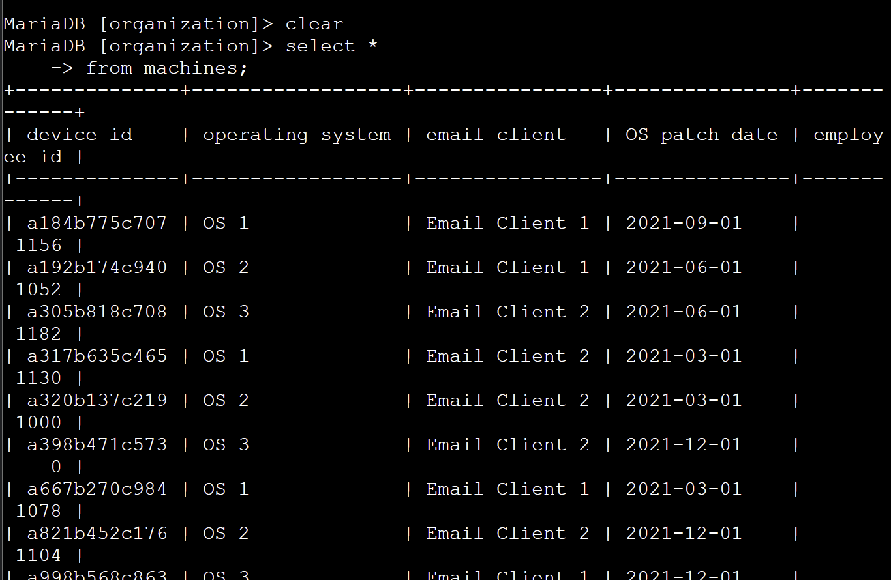
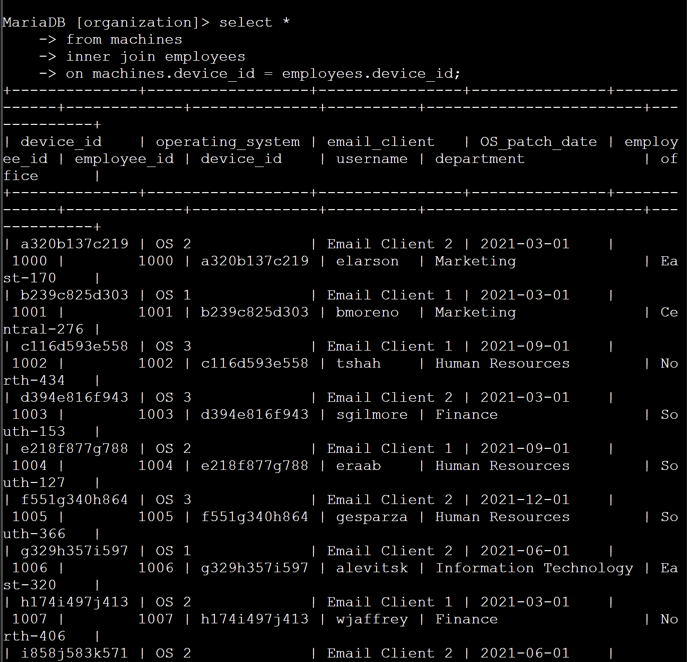
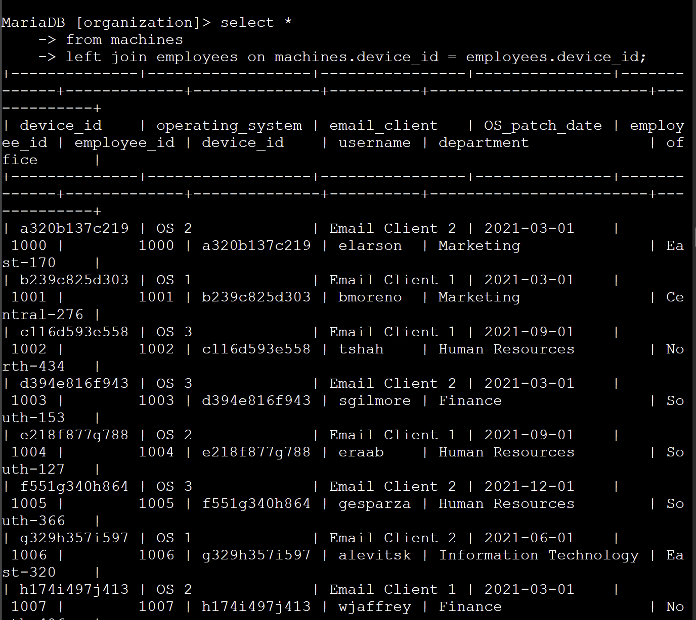
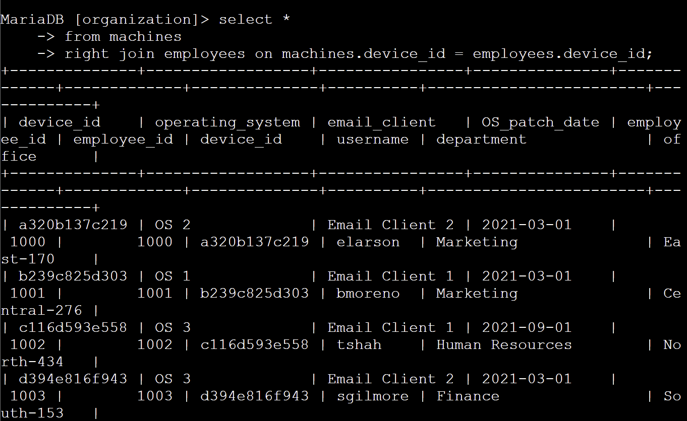
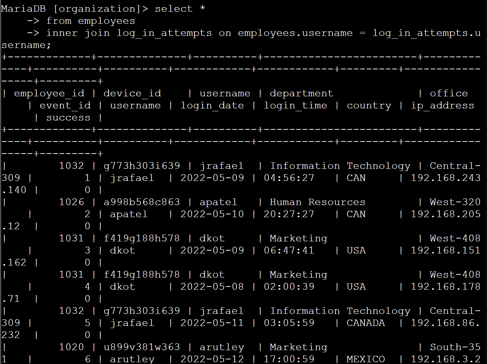

# SQL Security Investigation: Correlating User Data with Login Logs using JOINs

## Scenario
As a security analyst, I investigated a recent security incident compromising specific corporate machines. The objective was to correlate disconnected database tables to map employees to their assigned hardware and track their login activities to identify potential unauthorized access.

## Task
Utilize SQL `JOIN` operations (`INNER`, `LEFT`, `RIGHT`) within a MariaDB shell to merge records from the `employees`, `machines`, and `log_in_attempts` tables.

## Action
- Executed an `INNER JOIN` to map `machines` to `employees` based on matching `device_id` values, identifying which users operated specific hardware.
- Applied `LEFT JOIN` and `RIGHT JOIN` operations to discover anomalies, such as machines without assigned users or users lacking assigned devices.
- Performed a critical `INNER JOIN` linking the `employees` and `log_in_attempts` tables via the `username` column to create a unified view of each employee's login history, associated IPs, and department details.

## Outcome
Successfully synthesized fragmented database logs into actionable threat intelligence. This project demonstrates practical proficiency in relational database management, log correlation, and data enrichment for incident response.

## Query Execution Screenshots

