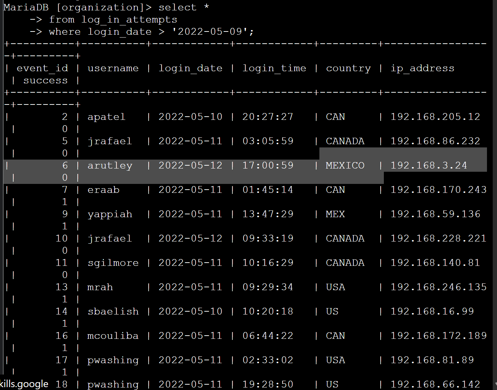
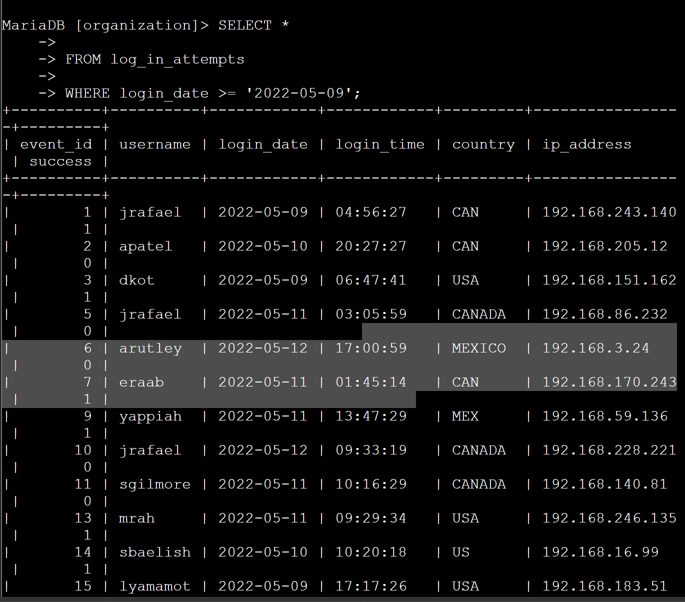
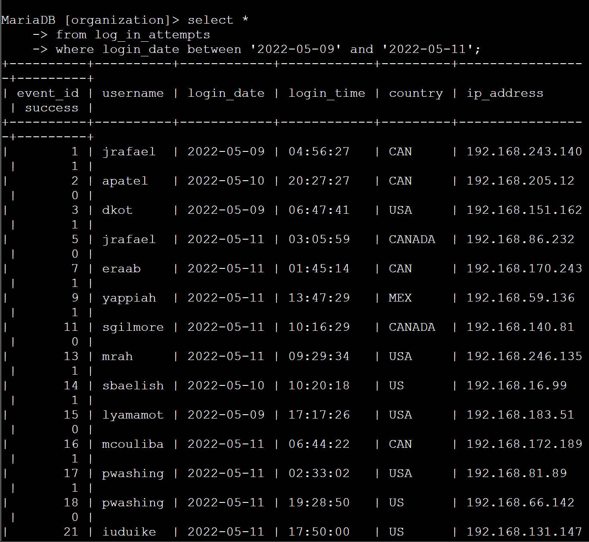
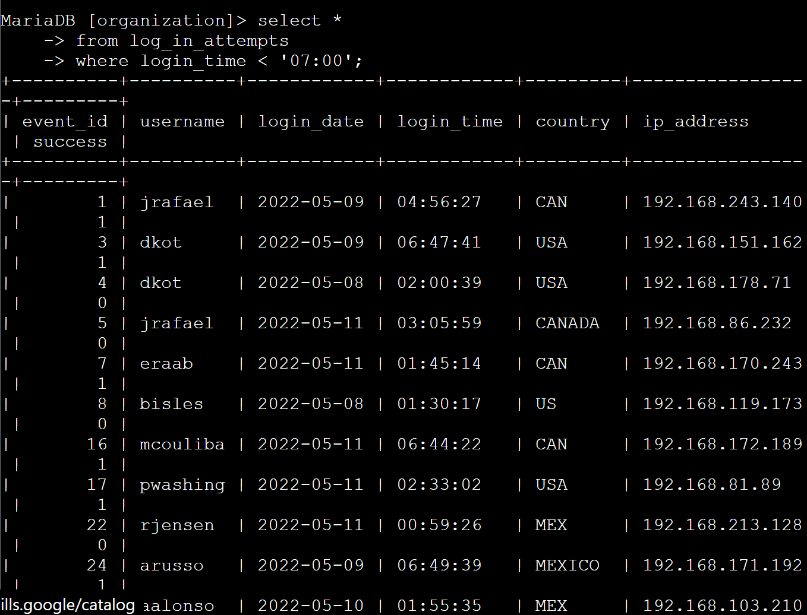
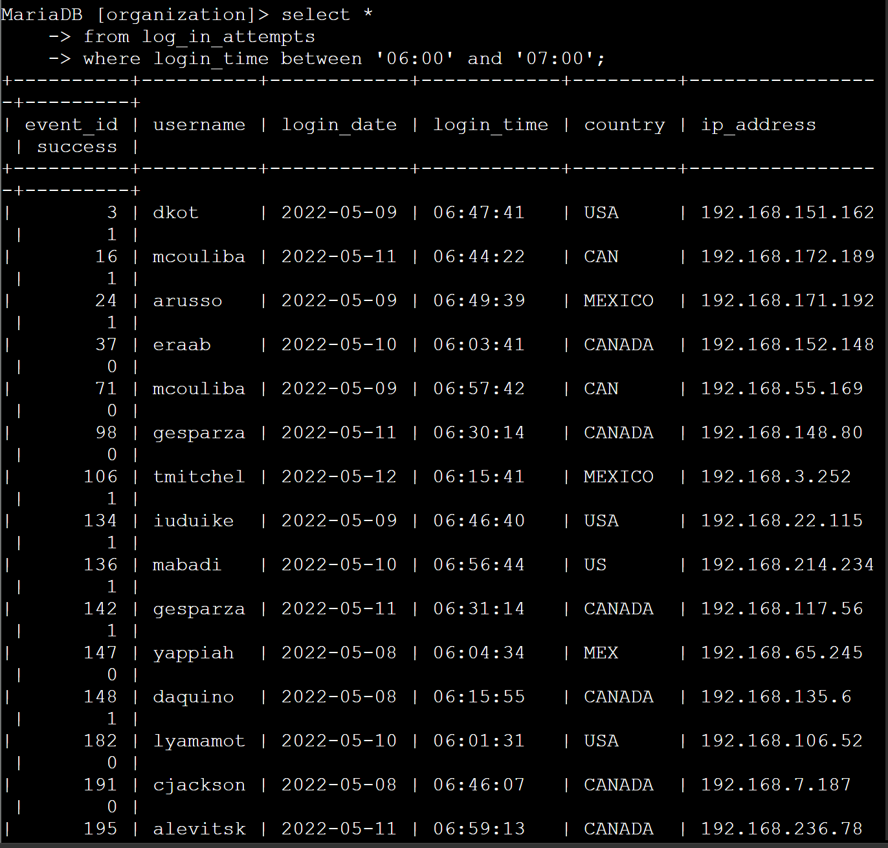
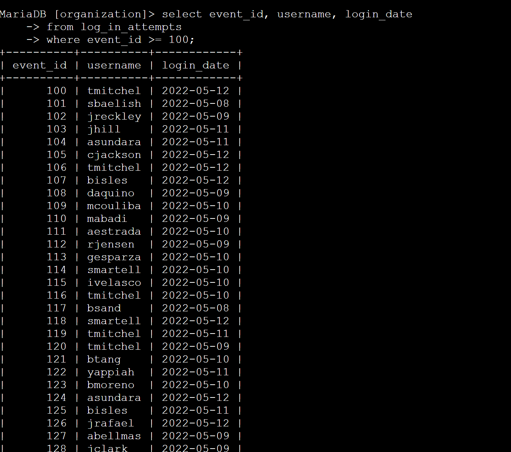
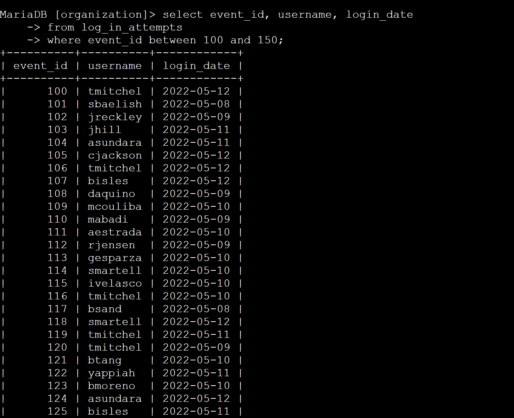

# SQL Security Investigation: Using Filters to Analyze Incident Logs

## Scenario
As a security analyst, I was tasked with investigating a recent security incident. The objective was to parse through extensive log data in the organization's database to pinpoint specific anomalous login activities associated with the breach.

## Task
Utilize SQL comparison and logical operators within a MariaDB shell to filter and isolate targeted security events from the `log_in_attempts` table based on specific dates, times, and event IDs.

## Action
- Applied comparison operators (`>`, `>=`, `<`) and the `BETWEEN` operator to filter login events occurring on, before, or after specific critical dates.
- Investigated after-hours network access by filtering `login_time` to identify connections made during non-business hours (e.g., prior to 07:00 AM).
- Correlated specific incident timelines by restricting the log output to a defined time window (`06:00` to `07:00`).
- Filtered specific blocks of events using `event_id` parameters (`>= 100` and `BETWEEN 100 AND 150`) to isolate the exact sequence of the suspected breach.

## Outcome
Successfully utilized SQL filtering techniques to sift through bulk data and isolate the specific parameters of a security incident. This project highlights practical SOC skills in incident response and log file analysis using database queries.

## Query Execution Screenshots

