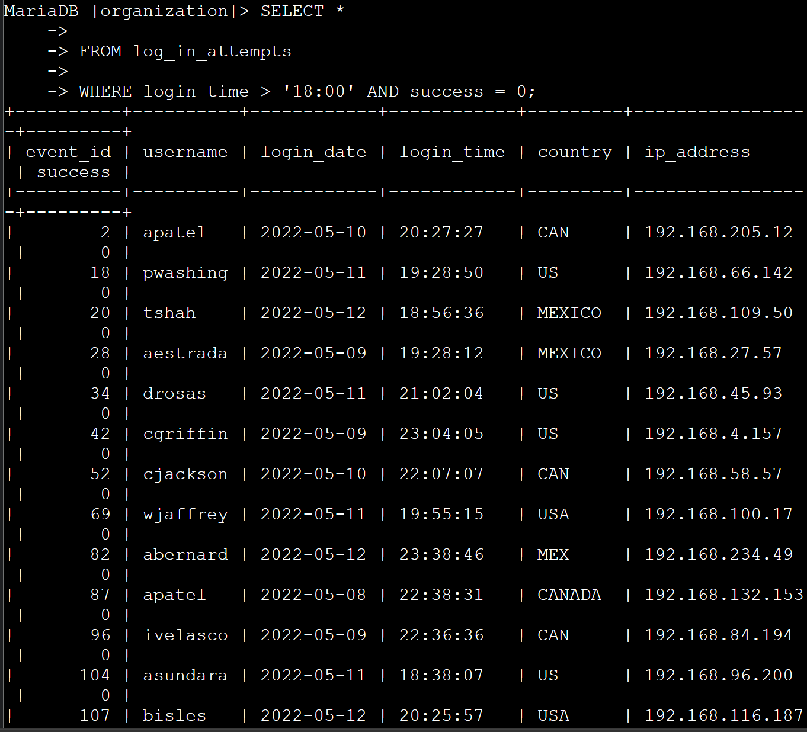
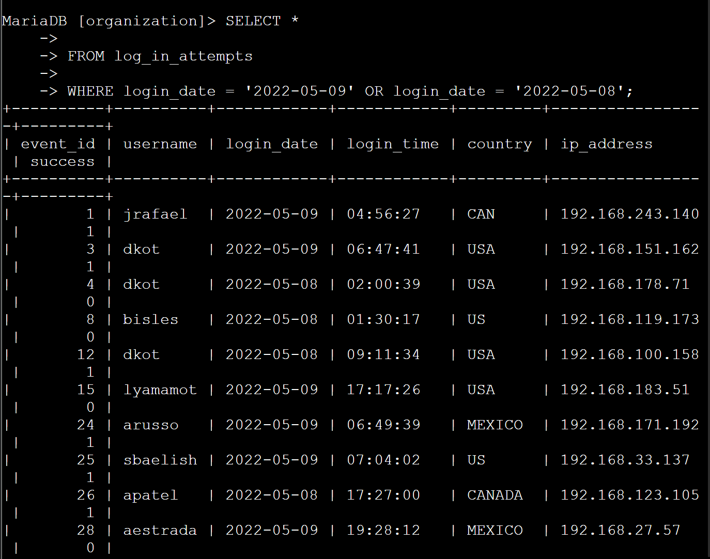
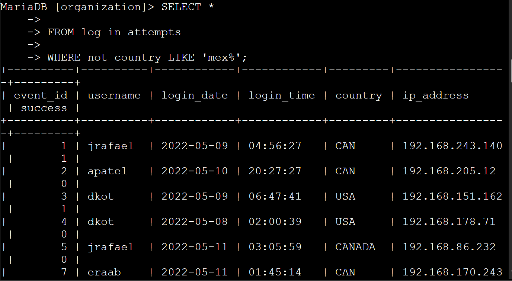
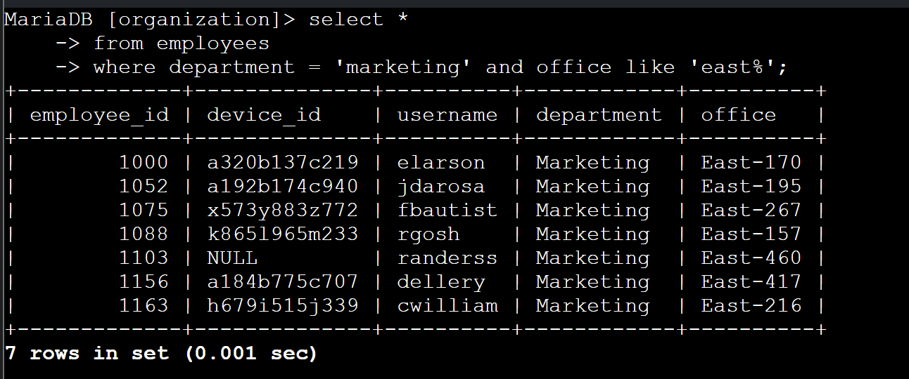
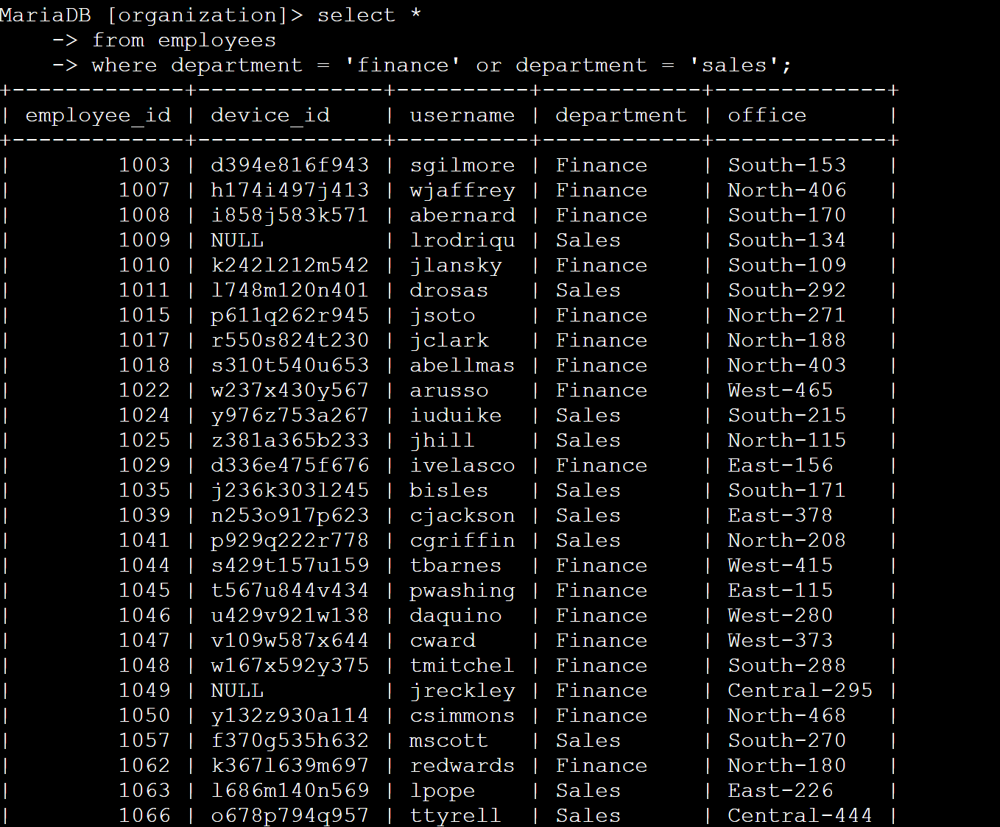
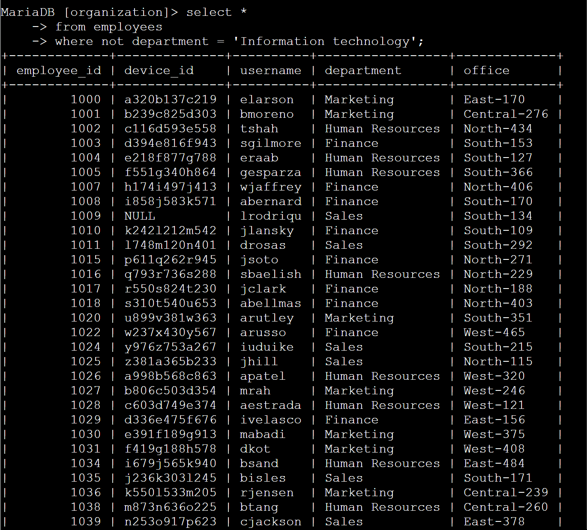

# SQL Security Investigation: Using Logical Operators for Threat Hunting

## Scenario
As a security professional, I was required to investigate potential security issues by filtering complex log data. The objective was to utilize logical operators to isolate specific threat indicators, such as after-hours failed logins and anomalous geolocation data.

## Task
Use SQL logical operators (`AND`, `OR`, `NOT`) and the `LIKE` operator within a MariaDB shell to filter the `log_in_attempts` table.

## Action
- Executed queries using the `AND` operator to find events meeting multiple conditions simultaneously, specifically isolating failed login attempts (`success = 0`) that occurred after business hours (`login_time > '18:00'`).
- Utilized the `OR` operator to filter logs for multiple specific dates of interest (`2022-05-09` or `2022-05-08`).
- Applied the `NOT` and `LIKE` operators to exclude expected geographical traffic (e.g., `not country LIKE 'mex%'`), thereby highlighting potentially anomalous international login attempts.

## Outcome
Effectively applied advanced SQL filtering combinations to uncover specific security events. This project demonstrates a strong capability to perform targeted threat hunting and log analysis within a relational database using strict logical parameters.

## Query Execution Screenshots

