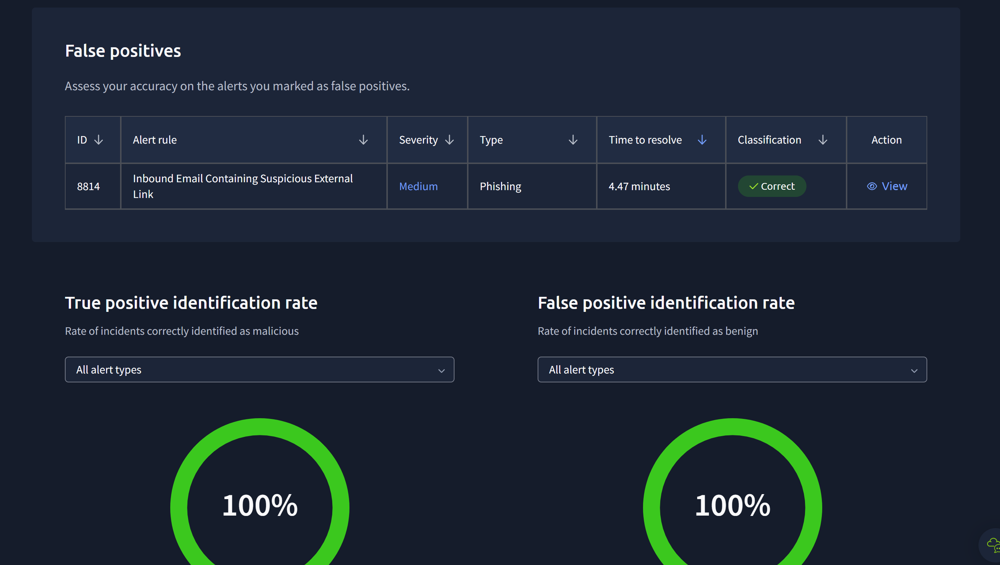
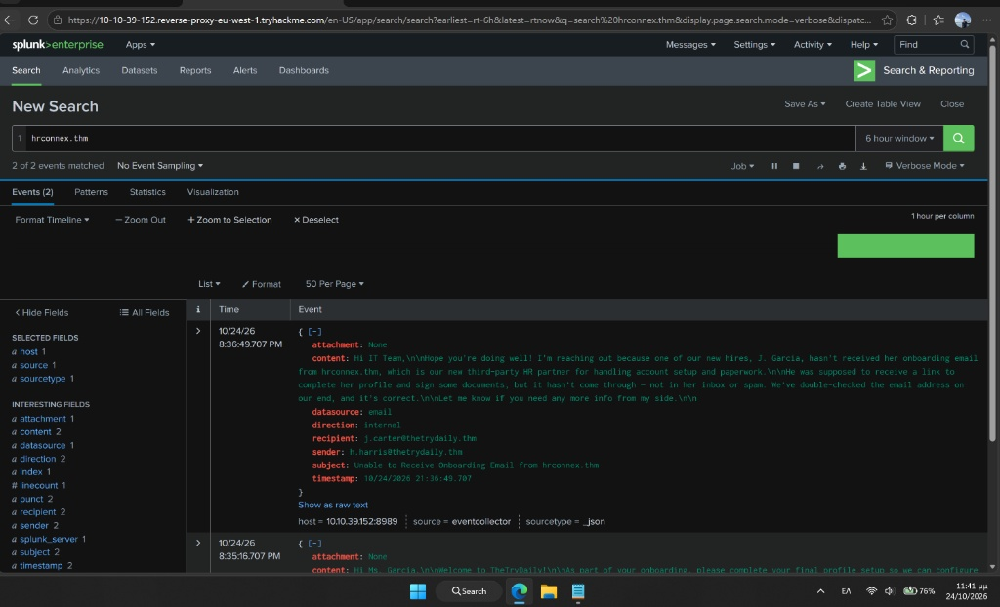
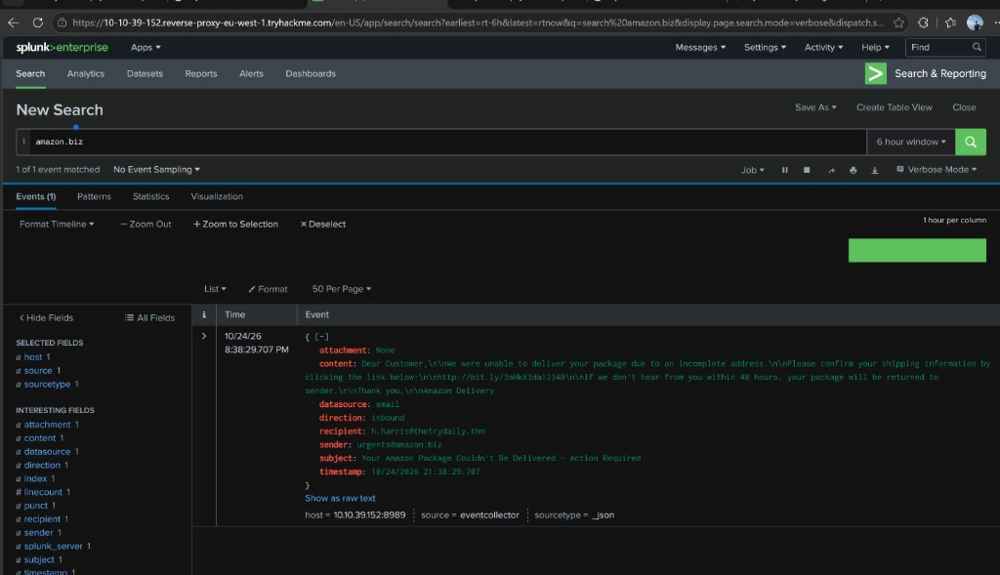
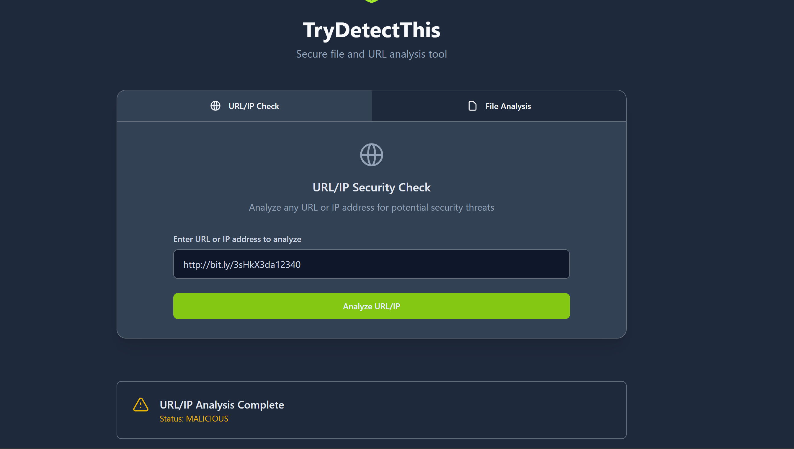
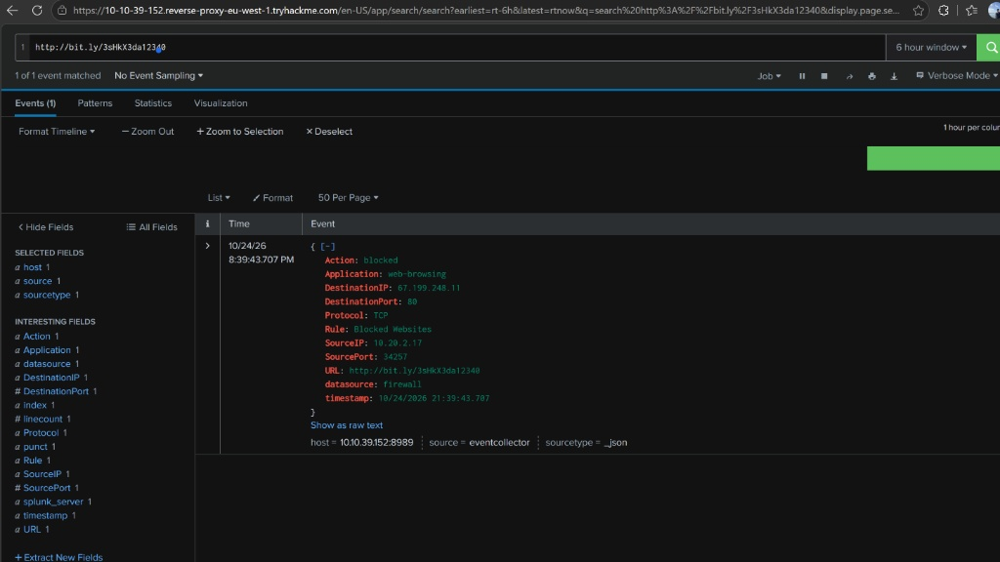
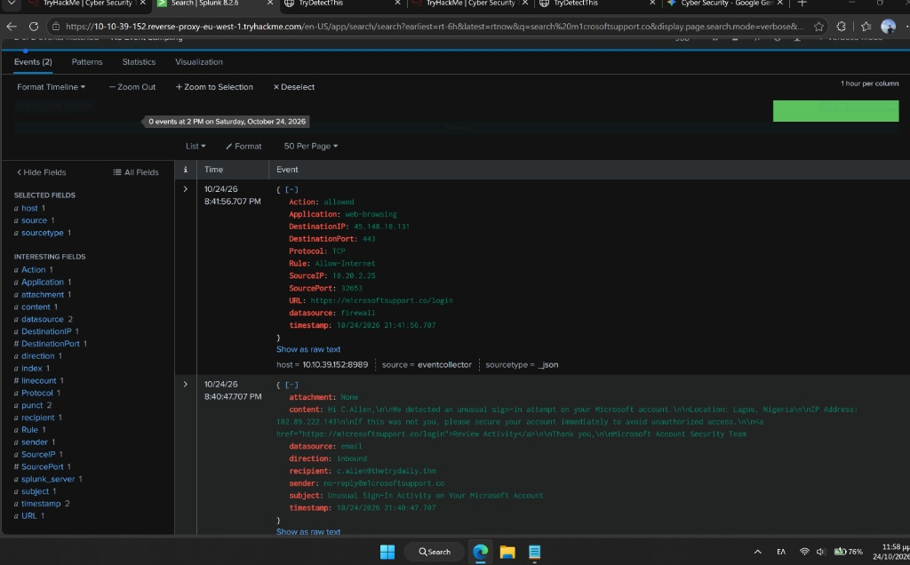

# 🛡️ SOC Shift Case Study: Phishing Alert Triage & SIEM Correlation (Splunk)

## 📌 Executive Summary
During a simulated L1 SOC shift (TryHackMe SOC Simulator), I investigated and triaged a queue of **4 high- and medium-severity phishing and perimeter firewall alerts**. By correlating email gateway telemetry with firewall proxy logs in **Splunk Enterprise** and verifying Indicators of Compromise (IoCs) via threat intelligence (**TryDetectThis**), I achieved a **100% True/False Positive identification rate**, successfully distinguishing legitimate third-party business operations from active credential harvesting attacks.

* **Tools Used:** Splunk Enterprise (SIEM), TryDetectThis (Threat Intelligence), Alert Queue & Case Management
* **Skills Demonstrated:** Alert Triage, SIEM Log Correlation, Phishing Analysis, Typosquatting Detection, Incident Escalation & Reporting

---

## 🔍 Incident 1: Alert ID 8814 — Suspicious External Onboarding Link
* **Alert Rule:** Inbound Email Containing Suspicious External Link
* **Severity:** Medium | **Classification:** 🟢 **False Positive (FP)** | **Escalation:** No

### 1. Alert Context & Entities
* **Timestamp:** `2026-10-24 21:35:16 UTC`
* **Sender:** `onboarding@hrconnex.thm`
* **Recipient:** `j.garcia@thetrydaily.thm`
* **Subject:** *Action Required: Finalize Your Onboarding Profile*
* **Extracted URL:** `[https://hrconnex.thm/onboarding/15400654060/j.garcia](https://hrconnex.thm/onboarding/15400654060/j.garcia)`

### 2. SIEM Investigation (Splunk)
* **SPL Query Executed:** `hrconnex.thm`
* **Findings:** Discovered an internal email (`21:36:49`) from HR (`h.harris@thetrydaily.thm`) to the IT Team (`j.carter@thetrydaily.thm`) confirming that **hrconnex.thm** is the company's newly onboarded third-party HR partner responsible for new-hire account setup for J. Garcia.

### 3. Analyst Verdict & Closure Rationale
Classified as a **False Positive**. The external domain belongs to a verified third-party HR vendor conducting legitimate onboarding activities. No malicious activity or unauthorized access occurred.

---

## 🚨 Incident 2: Alert IDs 8815 & 8816 — Shortened Phishing URL Blocked at Perimeter
* **Alert Rule:** Access to Blacklisted External URL Blocked by Firewall
* **Severity:** High | **Classification:** 🔴 **True Positive (TP)** | **Escalation:** No (Contained by Firewall)

### 1. Alert Context & Affected Entities
* **Timestamp:** `2026-10-24 21:38:29 UTC` (Email) / `21:39:43 UTC` (Firewall Block)
* **Affected User:** Hannah Harris (`h.harris@thetrydaily.thm` - HR Department)
* **Endpoint Hostname & IP:** `win-3457` (`10.20.2.17`)
* **Sender:** `urgents@amazon[.]biz`
* **Malicious URL:** `http://bit[.]ly/3sHkX3da12340`
* **Destination IP:** `67.199.248.11:80`

### 2. SIEM & Threat Intelligence Investigation
* **SPL Queries Executed:** `amazon.biz` and `http://bit.ly/3sHkX3da12340`
* **Email Correlation:** Identified an inbound phishing email spoofing Amazon Delivery (*"Your Amazon Package Couldn't Be Delivered - Action Required"*) containing the shortened URL `http://bit[.]ly/3sHkX3da12340`.

* **Threat Intel Verification:** Analyzed the URL in **TryDetectThis**, which flagged the indicator as **MALICIOUS**.

* **Perimeter Impact:** Firewall logs confirmed `Action: blocked` under rule `Blocked Websites`.

### 3. Analyst Verdict & Remediation
Classified as a **True Positive**, but **Escalation was not required** because the perimeter firewall proactively blocked the outbound HTTP connection before payload delivery or credential submission could occur.
* **Recommended Actions:** Keep `urgents@amazon[.]biz` and `67.199.248.11` on the blocklist, run a precautionary endpoint scan on `win-3457`, and notify the user regarding shortened URL risks.

---

## 🔥 Incident 3: Alert ID 8817 — Credential Harvesting via Typosquatted Domain
* **Alert Rule:** Inbound Email Containing Suspicious External Link
* **Severity:** Medium (Upgraded to Critical Impact) | **Classification:** 🔴 **True Positive (TP)** | **Escalation:** ⚠️ **YES (Escalated to L2)**

### 1. Alert Context & Affected Entities
* **Timestamp:** `2026-10-24 21:40:47 UTC` (Email) / `21:41:56 UTC` (Firewall Allowed)
* **Affected User:** C. Allen (`c.allen@thetrydaily.thm`)
* **Endpoint IP:** `10.20.2.25`
* **Sender:** `no-reply@m1crosoftsupport[.]co`
* **Phishing URL:** `https://m1crosoftsupport[.]co/login`
* **Destination IP:** `45.148.10.131:443`

### 2. SIEM & Threat Intelligence Investigation
* **SPL Query Executed:** `m1crosoftsupport.co`
* **Email Lure:** The user received a fake security alert claiming an *"Unusual Sign-In Attempt from Lagos, Nigeria"* urging immediate login at `https://m1crosoftsupport[.]co/login` (typosquatting `microsoft` using the number `1`).
* **Threat Intel Verification:** Confirmed as **MALICIOUS** via TryDetectThis.
* **Firewall Correlation (Critical Finding):** At `21:41:56`, host `10.20.2.25` initiated an outbound HTTPS connection (`Port 443`) to `45.148.10.131` (`https://m1crosoftsupport[.]co/login`) with **`Action: allowed`** under rule `Allow-Internet`.

### 3. Analyst Verdict & Escalation Rationale
Classified as a **True Positive** and **immediately escalated to L2 Incident Response**. Unlike the previous alert, the outbound connection bypassed perimeter blocks (`Action: allowed`), meaning the user reached the fraudulent login portal and likely exposed corporate credentials.

### 4. Recommended Remediation Actions
1. **Account Containment:** Force an immediate password reset for `c.allen@thetrydaily.thm` and revoke all active session tokens / OAuth grants.
2. **Network Blocking:** Block domain `m1crosoftsupport[.]co` and IP `45.148.10.131` on the corporate firewall and proxy.
3. **Endpoint Audit:** Inspect host `10.20.2.25` for any secondary payload execution or unauthorized persistence.

---

## 📊 Summary of Indicators of Compromise (IoCs)

| Indicator Type | Value (Defanged) | Verdict | Status |
| :--- | :--- | :--- | :--- |
| **Domain** | `hrconnex.thm` | Benign (HR Partner) | Allowed |
| **Email** | `urgents@amazon[.]biz` | Malicious (Phishing) | Blocked |
| **URL** | `http://bit[.]ly/3sHkX3da12340` | Malicious (Phishing) | Blocked |
| **IPv4** | `67.199.248.11` | Malicious | Blocked |
| **Email** | `no-reply@m1crosoftsupport[.]co` | Malicious (Typosquatting) | Escalated |
| **URL** | `https://m1crosoftsupport[.]co/login` | Malicious (Credential Harvesting) | Allowed / Escalated |
| **IPv4** | `45.148.10.131` | Malicious | Allowed / Escalated |
